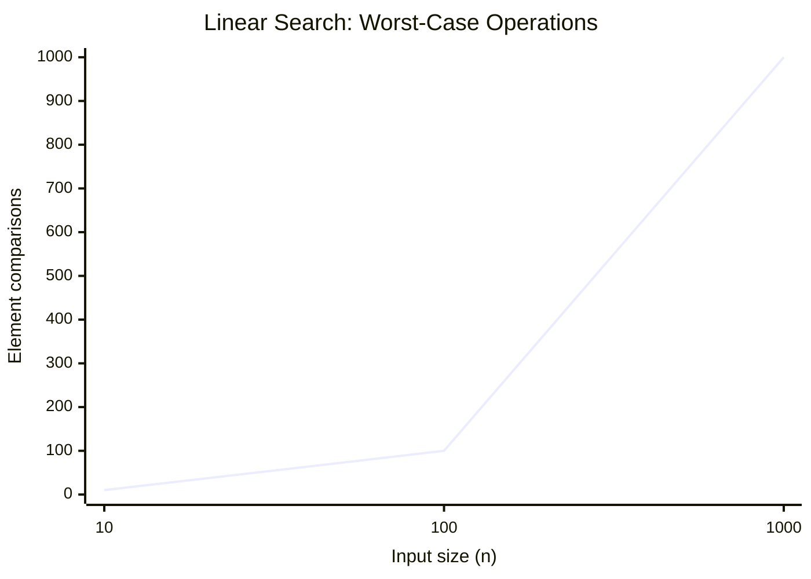
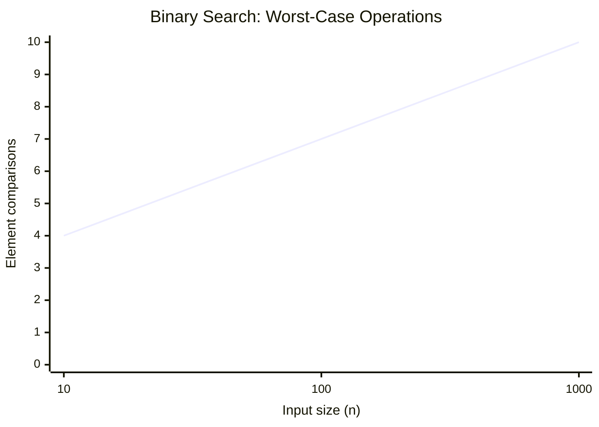

# Time Complexity

- It is used to measure efficincy of algorithm in terms of speed, as the input size grows

- Time complexity is not time taken by algorithm
  - Time complexity != Time Taken

- Time taken is depends in environment like where you are running the program
  - Machine
  - Processing power
  - ...etc

- Linear search checks up to `n` elements in the worst case, so its time complexity is `O(n)`.

- Binary search checks about `log₂(n)` elements in the worst case, so its time complexity is `O(log n)`.

- Big `O` notation: noted for the worst case scenarios

- Efficiency O(log n) >> O(n)

1. O(n) - looping to 1 -> n
   x = n , x -> represent number of operation
2. O(log n) - looping to log n times
   x = log n
3. O(n2) - looping the inside the loop
   x = n2
4. O(n log n) - looping to the nested loop logn times
   x = n log n

# Constant time complexity

- n = 10 x = 1
- n = 100 x = 1
- n = 1000 x = 1

# Space complexity

- How much extra space you are using in solutions
